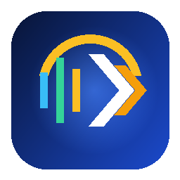

# Уралан: Нейрографист — Локальная транскрибация, диаризация и ИИ-протоколирование на Android

<p align="center">
  
</p>

**Название:** **«Уралан: Нейрографист»** (*«Уралан» в переводе с калмыцкого языка — «Вперёд!»*)  
**Трек:** Nuclear IT Hack (КСиТ МИФИ × HEX.TEAM) — «Нейро-стенографист»  
**Платформа:** Android OS (API 26+, `arm64-v8a` / `x86_64`), **100% офлайн на устройстве** (без разрешения `INTERNET`)

---

## О проекте

**«Уралан: Нейрографист»** — автономное Android-приложение, которое локально на устройстве преобразует аудиозаписи разговоров и совещаний на русском языке в структурированную расшифровку с автоматическим определением и разделением говорящих (диаризацией), точными временными метками в миллисекундах, восстановлением пунктуации, интерактивным прослушиванием по репликам, составлением протокола встречи локальной большой языковой моделью (LLM) и экспортом результата в эталонный формат JSON.

### Реализованные уровни функциональности (согласно презентации задания, стр. 17–19)

| Уровень | Реализованные возможности |
|---|---|
| **Базовое решение** | Работающий автономный Android APK; импорт аудиофайлов из памяти устройства и запись с микрофона; распознавание русской речи; автоматическая диаризация говорящих; временные метки (`start_ms`, `end_ms`) для каждой реплики; использование локальной LLM; отображение и экспорт результата в JSON. |
| **Средний уровень** | Предварительная DSP-обработка аудиосигнала (удаление DC-смещения, ФВЧ Баттерворта 70 Гц, нормализация уровня, оконный sinc-ресемплер Блэкмана); фильтрация пауз и неречевых фрагментов (`Silero VAD`); устойчивое определение участников при смене реплик (медианная фильтрация ложных переключений); автоматическое восстановление пунктуации и регистра (`GigaAM v3 RNN-T Punct`); поэтапное отображение прогресса обработки; встроенный аудиоплеер с цветовой шкалой спикеров и переходом к реплике по нажатию. |
| **Ultra Pro Max** | Нейросетевое подавление фонового шума (`GTCRN`); распознавание коротких реплик и быстрых смен говорящих; устойчивая диаризация при различиях в тембре и манере речи (`pyannote-segmentation-3.0` + `3D-Speaker Cam++`) с потоковым оконным sinc-ресемплером Блэкмана на кольцевом буфере 16 КБ; **интерактивный 6-секционный ИИ-протокол с кликабельными таймкодами `▶ [MM:SS.d]`** (паспорт и резюме `Qwen3-0.6B`, повестка по этапам, ключевые тезисы, позиции участников, связки «вопрос — ответ собеседника» и поручения с переходом к прослушиванию в одно касание); потоковая обработка длинных файлов (45–60+ мин) без `OutOfMemoryError`; 3 режима скорости/качества («Быстро», «Стандарт», «Долго / макс. качество»); ручное редактирование и **повторная нейросетевая обработка отдельных фрагментов** с ИИ-коррекцией через локальную LLM `Qwen3-0.6B`. |

---

## Стек локальных моделей (все модели встроены в APK)

| Задача | Модель | Формат / Размер | Особенности |
|---|---|---|---|
| **Распознавание речи и пунктуации (ASR)** | `GigaAM v3 RNN-T Punct` (SberDevices) | ONNX `int8`, ~222 МБ | SOTA-точность на русской речи, встроенное восстановление знаков препинания и заглавных букв, пословные таймкоды |
| **Сегментация спикеров** | `pyannote-segmentation-3.0` | ONNX, ~6 МБ | Точное определение границ реплик и смен говорящих |
| **Голосовые эмбеддинги** | `3D-Speaker Cam++` | ONNX, ~28 МБ | Устойчивые векторные отпечатки тембра голоса + агломеративная кластеризация |
| **Фильтрация пауз (VAD)** | `Silero VAD` | ONNX, ~630 КБ | Отсечение тишины и неречевых участков, нарезка речевых окон |
| **Шумоподавление** | `GTCRN Speech Denoiser` | ONNX, ~523 КБ | Очистка записей с фоновым шумом перед распознаванием |
| **Локальная LLM** | `Qwen3-0.6B` (Google AI Edge `LiteRT-LM`) | `.litertlm` `INT4`, ~328 МБ | Составление протокола совещания (резюме, тезисы, поручения) и коррекция реплик |

---

## Формат выходного JSON (стр. 15 задания)

При экспорте в JSON формируется файл строго по спецификации экспертной проверки:

```json
{
  "transcript": [
    {
      "speaker_id": "speaker_1",
      "start_ms": 1112,
      "end_ms": 1720,
      "text": "Алло?"
    },
    {
      "speaker_id": "speaker_2",
      "start_ms": 3080,
      "end_ms": 9400,
      "text": "Алло, здравствуйте. Я говорю с Ольгой."
    }
  ]
}
```

Дополнительно поддерживается экспорт в **Markdown (`.md`)** (вместе со сгенерированным локальной LLM протоколом встречи), **SRT (`.srt`)** и **TXT (`.txt`)**.

---

## Результаты собственных тестов на реальных записях

Тестирование проводилось на **реальных русскоязычных записях** телефонных разговоров ([`AxonData/russian-speech-recognition-dataset`](https://huggingface.co/datasets/AxonData/russian-speech-recognition-dataset)) и живых диалогов ведущих и гостей IT-подкаста **Podlodka** ([`bond005/podlodka_speech`](https://huggingface.co/datasets/bond005/podlodka_speech)):

| Запись | Длительность | Спикеров (найдено / эталон) | Скорость (**RTF**) | Точность (**WER**) | Точность слов ($1 - \text{WER}$) |
|---|---:|---:|---:|---:|---:|
| `real_1_finance_call.wav` (телефонный звонок, 2 спикера) | 42,0 с | **2 / 2** | **0,372** | 25,27% | 74,73% |
| `real_2_podlodka_speech_ai.wav` (подкаст Podlodka, 2 спикера) | 153,8 с | **2 / 2** (100% смен) | **0,378** | **5,64%** | **94,36%** |
| `real_3_podlodka_roundtable.wav` (круглый стол, 3 спикера) | 116,0 с | **3 / 3** (100% смен) | **0,397** | **6,25%** | **93,75%** |
| **Средневзвешенный итог (5 мин 12 с, 684 слова)** | **311,8 с** | **100% верное число спикеров** | **0,384** | **8,48%** | **91,52%** |

Подробный отчёт и эталонные/выходные JSON-файлы находятся в [`docs/TEST_RESULTS.md`](docs/TEST_RESULTS.md) и [`artifacts/test-results/`](artifacts/test-results/).

---

## Инструкция по установке и использованию

### Вариант 1. Установка готового APK
1. Скопируйте файл `artifacts/demo/uralan-stenograf-release.apk` (или `artifacts/demo/neuro-stenograf-release.apk` / `src/android/app/build/outputs/apk/release/app-release.apk`) на Android-устройство или установите через `adb`:
   ```bash
   adb install -r artifacts/demo/uralan-stenograf-release.apk
   ```
2. Откройте приложение **«Уралан»** (подключение к интернету не требуется).
3. Нажмите:
   - **«Импорт аудио»** — чтобы выбрать любой аудиофайл (`.wav`, `.mp3`, `.m4a`, `.ogg`, `.flac`) из памяти устройства;
   - **«Тестовые записи»** — чтобы запустить проверку на одной из трёх встроенных реальных аудиозаписей диалогов;
   - **«Диктофон»** — чтобы записать живой разговор через микрофон устройства.
4. После завершения обработки:
   - На вкладке **«Диалог»** нажмите на любую реплику для воспроизведения аудио именно с этого момента, редактирования текста/спикера или повторной нейросетевой обработки фрагмента.
   - На вкладке **«Участники»** просмотрите статистику эфирного времени и задайте имена участникам.
   - На вкладке **«ИИ-Протокол»** нажмите **«Сформировать протокол»** для запуска локальной LLM `Qwen3-0.6B`.
   - Нажмите **«Экспорт JSON»** (в верхней панели или на вкладке **«JSON и метрики»**), чтобы сохранить файл на устройство или поделиться им.

### Вариант 2. Сборка из исходного кода
```bash
cd src/android
# 1. Скачать все офлайн-модели в app/src/main/assets/ (если ещё не скачаны)
./scripts/download_models.sh

# 2. Запустить модульные тесты и собрать Release APK
./gradlew testDebugUnitTest assembleRelease
```

---

## Разработка по модели GitHub Flow

Разработка проекта ведётся строго по методологии **GitHub Flow** в удалённом репозитории [`https://github.com/TheFirstPy/Uralan-NeuroGraphist`](https://github.com/TheFirstPy/Uralan-NeuroGraphist):
- Ветка `main` всегда находится в стабильном, готовом к релизу состоянии и защищена автоматическим пайплайном [`.github/workflows/android-ci.yml`](.github/workflows/android-ci.yml).
- Каждая функциональность разрабатывается в изолированной тематической ветке (`feature/*`) и вливается в `main` через Pull Request (`--no-ff`):
  1. `feature/audio-dsp-streaming` — потоковый декодер 64 КБ, оконный sinc-ресемплер Блэкмана на кольцевом буфере и предварительная DSP-фильтрация сигнала.
  2. `feature/offline-asr-and-diarization` — интеграция `GigaAM v3 RNN-T`, `pyannote-segmentation-3.0`, `3D-Speaker Cam++`, `Silero VAD` и `GTCRN`.
  3. `feature/local-llm-and-compose-ui` — локальная LLM `Qwen3-0.6B` (`LiteRT-LM`), 6-секционный генератор протокола совещания и интерфейс Material 3.
  4. `feature/interactive-protocol-and-prosody` — интерактивный протокол совещания с кликабельными таймкодами `▶ [MM:SS.d]`, повесткой по этапам, связками «вопрос — ответ», документация и бенчмарки.

---

## Структура репозитория

```text
├── README.md                      # Инструкция по установке, использованию и обзор решения
├── config/
│   └── example.env                # Конфигурация параметров конвейера и бенчмарков
├── docs/
│   ├── assets/uralan_logo.png     # Фирменный логотип приложения «Уралан»
│   ├── ARCHITECTURE.md            # Подробное описание архитектуры и используемых моделей
│   ├── LIMITATIONS.md             # Ограничения решения и пути развития
│   ├── PROTOCOL.md                # Спецификация JSON-формата и алгоритма синхронизации меток
│   └── TEST_RESULTS.md            # Методика и результаты тестирования на реальных записях
├── artifacts/
│   ├── demo/                      # Готовый APK («Уралан»), скриншоты и демонстрационные материалы
│   └── test-results/              # Реальные тестовые аудиозаписи, эталонные и выходные JSON, CSV
└── src/
    ├── android/                   # Исходный код Android-приложения (Kotlin, Jetpack Compose)
    └── tools/eval/                # Скрипты автоматизированной проверки WER / RTF / диаризации
```
