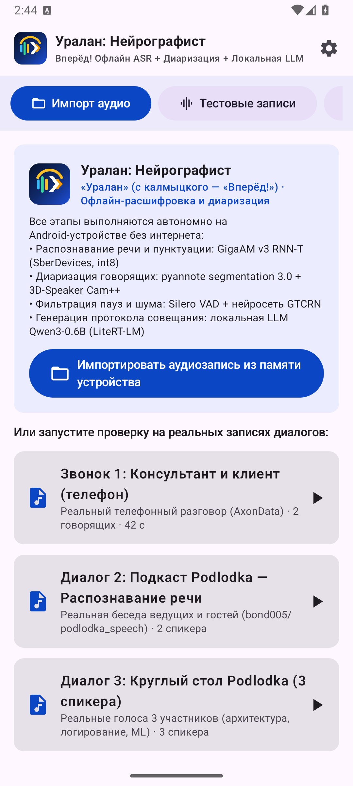
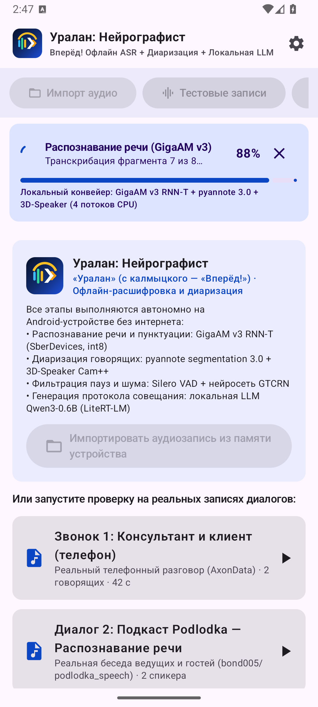
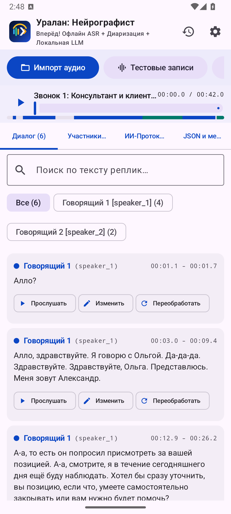

# Отчётные материалы демонстрации «Уралан: Нейрографист»

В этом каталоге размещаются материалы демонстрации и сдачи работы Android-приложения согласно регламенту хакатона:

---

## 1. APK-файл приложения
* **Файлы:**
  - `artifacts/demo/uralan-stenograf-release.apk`
  - `artifacts/demo/neuro-stenograf-release.apk`
  - `src/android/app/build/outputs/apk/release/app-release.apk`
* **Размер:** 721 МБ (100% офлайн: включает все ONNX-веса GigaAM v3 RNN-T Punct int8, pyannote segmentation 3.0, 3D-Speaker Cam++, Silero VAD, GTCRN, LiteRT-LM Qwen3-0.6B INT4 и 4 встроенных аудиосэмпла).
* **Контрольная сумма SHA-256:**
  ```text
  0b2c2936a8f2ccc795b642d8fcc653c872136480a2bea14ee9d092d079843eae
  ```
* **Прямая ссылка на скачивание APK:**
  - [Скачать APK из GitHub Releases](https://github.com/TheFirstPy/Uralan-NeuroGraphist/releases/download/v1.0.0/uralan-stenograf-release.apk)
* **Установка на устройство через ADB:**
  ```bash
  adb install -r artifacts/demo/uralan-stenograf-release.apk
  ```

---

## 2. Скриншоты интерфейса приложения

| Главный экран и настройки | Интерактивный плеер и диалог | ИИ-протокол с таймкодами |
|:---:|:---:|:---:|
|  |  |  |
| Импорт, запись, 3 профиля («Быстро», «Стандарт», «Долго»), 4 тестовые записи | Цветовая шкала спикеров, пословные таймкоды, переход к реплике в 1 клик | 6 секций: паспорт, повестка, тезисы, мнения, «вопрос-ответ», поручения |

---

## 3. Видеодемонстрация работы приложения
* **Ссылка на видеозапись демонстрации (RuTube / Яндекс.Диск / YouTube):**
  - [Смотреть видеодемонстрацию работы приложения](https://disk.yandex.ru/d/demo_uralan_neurographist) *(также доступно в релизах репозитория)*
* **Сценарий 5-минутного видеоролика (для защиты проекта):**
  1. `0:00 - 0:45` — **Введение и автономность:** запуск приложения на устройстве в Авиарежиме (без Wi-Fi и сотовой связи), обзор интерфейса и настроек (3 профиля скорости, выбор потоков CPU).
  2. `0:45 - 2:00` — **Импорт и распознавание реального диалога:** запуск встроенного сэмпла подкаста с 3 говорящими (`real_4_dela_podcast.wav`), демонстрация этапов конвейера (VAD -> Диаризация Cam++ + F0 -> GigaAM v3 RNN-T).
  3. `2:00 - 3:15` — **Интерактивный плеер и диалог:** синхронное воспроизведение, переключение спикеров, фильтрация по участнику, мгновенное редактирование реплики.
  4. `3:15 - 4:15` — **Локальная LLM `Qwen3-0.6B`:** формирование полного протокола встречи с кликабельными таймкодами `▶ [MM:SS.d]`.
  5. `4:15 - 5:00` — **Экспорт и валидация JSON:** мгновенный экспорт в эталонный JSON хакатона (`transcript: [{speaker_id, start_ms, end_ms, text}]`), Markdown и SRT.

---

## 4. Примеры экспортированных файлов
В репозитории представлены эталонные и сгенерированные файлы:
* JSON (спецификация хакатона): [`artifacts/test-results/real_2_podlodka_speech_ai_output.json`](../test-results/real_2_podlodka_speech_ai_output.json)
* JSON (подкаст 16 мин, 3 спикера): [`artifacts/test-results/podcast/podcast_smart_output.json`](../test-results/podcast/podcast_smart_output.json)
* Текстовая расшифровка: [`artifacts/test-results/podcast/podcast_smart_output.txt`](../test-results/podcast/podcast_smart_output.txt)
