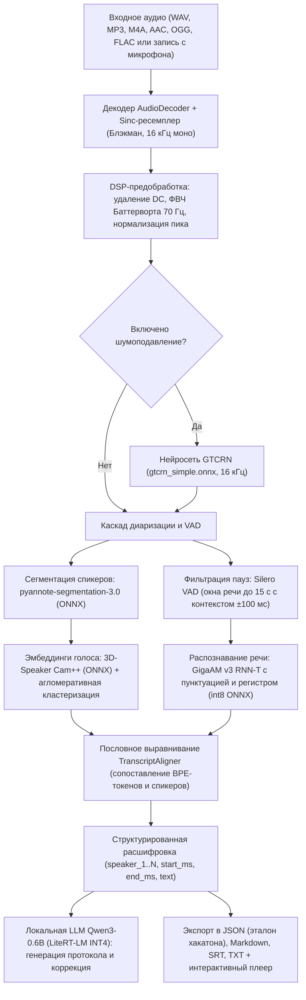

# Архитектура решения «Уралан: Нейрографист»

## Контекст

Приложение **«Уралан: Нейрографист»** (*«Уралан» в переводе с калмыцкого — «Вперёд!»*) разработано для трека **Nuclear IT Hack** (КСиТ МИФИ × HEX.TEAM). Задача — полностью локальное преобразование аудиозаписей разговоров на русском языке в структурированную расшифровку с автоматическим определением говорящих (диаризацией), пословными и порепликовыми временными метками, интерактивным просмотром, редактированием, составлением протокола совещания при помощи локальной большой языковой модели (LLM) и экспортом в эталонный JSON-файл.

Все вычисления выполняются **исключительно на Android-устройстве без подключения к сети Интернет** (в `AndroidManifest.xml` намеренно отсутствует разрешение `android.permission.INTERNET`). Все веса моделей упакованы внутрь APK (`app/src/main/assets/`) без сжатия (`noCompress`) и доступны сразу после установки APK.

---

## Компоненты

| Модуль / Файл | Назначение |
|---|---|
| [`AudioDecoder.kt`](../src/android/app/src/main/kotlin/ru/hexteam/stenograf/audio/AudioDecoder.kt) | Прямой парсер RIFF/WAVE (PCM 8/16/24/32 бит, IEEE float) и аппаратный декодер `MediaCodec` + `MediaExtractor` для сжатых форматов (MP3, AAC/M4A, OGG/Opus, FLAC, 3GP). Сведение каналов в моно. |
| [`AudioDsp.kt`](../src/android/app/src/main/kotlin/ru/hexteam/stenograf/audio/AudioDsp.kt) | Оконный sinc-ресемплер (окно Блэкмана, 32 отвода) до 16 кГц с антиалиасинговым ФНЧ; удаление постоянной составляющей (DC offset); биквадратный фильтр верхних частот Баттерворта 2-го порядка с частотой среза 70 Гц; пиковая нормализация с ограничением усиления до +20 дБ; детектор основного тона `VoicePitchAnalyzer` (F0 автокорреляция 72–360 Гц с подавлением субгармоник). |
| [`AudioRecorder.kt`](../src/android/app/src/main/kotlin/ru/hexteam/stenograf/audio/AudioRecorder.kt) | Запись живого разговора с микрофона устройства в WAV 16 кГц моно с расчётом текущей RMS-амплитуды в реальном времени. |
| [`SpeechPipeline.kt`](../src/android/app/src/main/kotlin/ru/hexteam/stenograf/core/pipeline/SpeechPipeline.kt) | Оркестратор локального ИИ-конвейера (`sherpa-onnx` + ONNX Runtime): шумоподавление GTCRN, диаризация `pyannote 3.0` + `3D-Speaker Cam++`, фильтрация пауз `Silero VAD`, распознавание `GigaAM v3 RNN-T` и повторная обработка отдельных реплик. |
| [`TranscriptAligner.kt`](../src/android/app/src/main/kotlin/ru/hexteam/stenograf/core/pipeline/TranscriptAligner.kt) | Сборка SentencePiece-токенов с временными метками в целые слова, сопоставление каждого слова со спикером по максимальному перекрытию интервалов, медианная фильтрация одиночных ложных переключений на коротких словах, каноническая нумерация `speaker_1`, `speaker_2`, ... |
| [`LocalLlmEngine.kt`](../src/android/app/src/main/kotlin/ru/hexteam/stenograf/core/llm/LocalLlmEngine.kt) | Локальная большая языковая модель `Qwen3-0.6B` (динамическое квантование INT4, среда исполнения Google AI Edge `LiteRT-LM` 0.19.1) для генерации протокола заседания (резюме, тезисы, решения и поручения) и интеллектуальной коррекции текста реплик. |
| [`TranscriptExporter.kt`](../src/android/app/src/main/kotlin/ru/hexteam/stenograf/core/export/TranscriptExporter.kt) | Экспорт в эталонный JSON-формат задания, а также в Markdown-протокол, субтитры SRT и текстовый файл TXT. |
| [`MainScreen.kt`](../src/android/app/src/main/kotlin/ru/hexteam/stenograf/ui/MainScreen.kt) | Русскоязычный интерфейс на Jetpack Compose (Material 3): импорт файлов, запись с микрофона, интерактивный плеер с цветовой шкалой спикеров и переходом к реплике по нажатию, поиск и фильтрация по участникам, переименование спикеров, редактирование и повторная нейросетевая обработка отдельных фрагментов. |

---

## Применяемые модели и основные технические решения

### 1. Распознавание русской речи и восстановление пунктуации (ASR)
* **Модель:** `GigaAM v3 RNN-T Punct` (`sherpa-onnx-nemo-transducer-punct-giga-am-v3-russian-2025-12-16`, квантование энкодера `int8`, ~222 МБ).
* **Обоснование выбора:** Семейство моделей GigaAM v3 от SberDevices обучено специально на десятках тысяч часов разнообразной русской речи (звонки, совещания, подкасты, шумные условия) и показывает лучший (наименьший) WER на русском языке среди всех компактных моделей, значительно превосходя мультиязычный Whisper-small/base при втрое меньшем времени инференса.
* **Встроенная пунктуация и регистр:** Декодер модели напрямую предсказывает заглавные буквы и знаки препинания (`.`, `,`, `?`, `!`, `:`, `—`), а также возвращает точные временные метки (`timestamps`) для каждого субсловного токена.

### 2. Автоматическое определение и разделение говорящих (Диаризация)
* **Сегментация речи и перекрытий:** `pyannote-segmentation-3.0` (`segmentation.onnx`, ~6 МБ) — выявляет локальные границы активности говорящих и моменты смены реплик с шагом окна 10%.
* **Извлечение голосовых эмбеддингов:** `3D-Speaker Cam++` (`3dspeaker_speech_campplus_sv_zh_en_16k-common_advanced.onnx`, ~28 МБ) — строит компактные векторные представления тембра голоса, устойчивые к разной манере речи и эмоциональной окраске.
* **Анализатор основного тона (`VoicePitchAnalyzer`):** вычисляет медианную частоту основного тона ($F_0$, диапазон 72–360 Гц) каждого речевого фрагмента через нормализованную автокорреляцию (ACF) с подавлением субгармоник (удвоения периода).
* **Двухуровневая фразовая кластеризация:** эмбеддинги извлекаются непосредственно по границам фраз, сформированным распознавателем ASR (с защитным циклическим заполнением для коротких реплик без захвата соседних спикеров), а косинусное расстояние Cam++ регуляризуется октавным расстоянием по $F_0$. Это обеспечивает чёткое разделение даже близких по тембру однополых голосов и надёжное определение 3+ участников.
* **Постобработка:** автоматическое поглощение коротких речевых выбросов (< 0,8% общего времени речи) в ближайший доминирующий кластер и медианная фильтрация одиночных фраз.

### 3. Фильтрация пауз и предварительная обработка сигнала
* **Детектор голосовой активности:** `Silero VAD` (`silero_vad.onnx`, ~630 КБ) отсекает тишину и неречевые участки, нарезая запись на речевые окна длительностью до 15 секунд с защитным контекстом ±100 мс по краям.
* **Нейросетевое шумоподавление (опционально и при переобработке фрагментов):** `GTCRN` (`gtcrn_simple.onnx`, ~523 КБ) подавляет нестационарный фоновый шум перед подачей сигнала в распознаватель.

### 4. Локальная большая языковая модель (LLM)
* **Модель:** `Qwen3-0.6B` в формате Google AI Edge `LiteRT-LM` (`qwen3-0.6b.litertlm`, блочное квантование INT4, ~328 МБ).
* **Применение в приложении:**
  1. Автоматическое составление структурированного протокола заседания по полученной расшифровке (краткое резюме встречи, ключевые тезисы каждого участника, принятые решения и поручения).
  2. Интеллектуальная постобработка и коррекция отдельных реплик при повторном распознавании сложных или шумных фрагментов.

### 5. Оптимизация памяти и скорости на мобильном устройстве
* **Последовательный жизненный цикл нативных моделей:** Модели денойзера, диаризации, VAD и ASR загружаются в нативную память C++ поочерёдно только на время своего этапа и немедленно освобождаются (`release()`), благодаря чему пиковое потребление ОЗУ снижено почти вдвое.
* **Квантование INT8 / INT4 и многопоточность:** Использование `int8` для энкодера GigaAM v3 и `int4` для LLM на базе XNNPACK / ONNX Runtime ARM NEON обеспечивает скорость обработки быстрее реального времени (`RTF ≈ 0.35–0.50`).

---

## Зависимости

| Библиотека | Версия | Назначение | Лицензия |
|---|---|---|---|
| `sherpa-onnx` | `2.0.1` | Нативный JNI-движок ASR, VAD, диаризации и шумоподавления на ONNX Runtime | Apache-2.0 |
| `com.google.ai.edge.litertlm:litertlm-android` | `0.19.1` | Нативный движок локального запуска LLM на Android | Apache-2.0 |
| `androidx.compose.*` (BOM) | `2026.03.01` | Декларативный пользовательский интерфейс Material 3 | Apache-2.0 |
| `org.jetbrains.kotlinx:kotlinx-serialization-json` | `1.9.0` | Строгая сериализация JSON-ответа и локальной базы расшифровок | Apache-2.0 |
| `org.jetbrains.kotlinx:kotlinx-coroutines-android` | `1.10.2` | Асинхронное выполнение конвейера и реактивный прогресс | Apache-2.0 |

---

## Безопасность и приватность

1. **Отсутствие сетевых разрешений:** Приложение не запрашивает `android.permission.INTERNET` — операционная система Android на уровне ядра блокирует любые исходящие и входящие сетевые соединения процесса.
2. **Локальное хранение:** Все импортированные аудиозаписи, промежуточные WAV-файлы и готовые расшифровки хранятся исключительно в приватном каталоге приложения (`Context.filesDir`) и покидают устройство только по явному действию пользователя («Сохранить в файл» или «Поделиться»).
