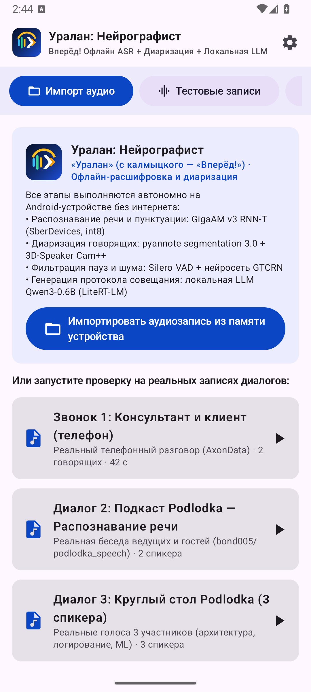
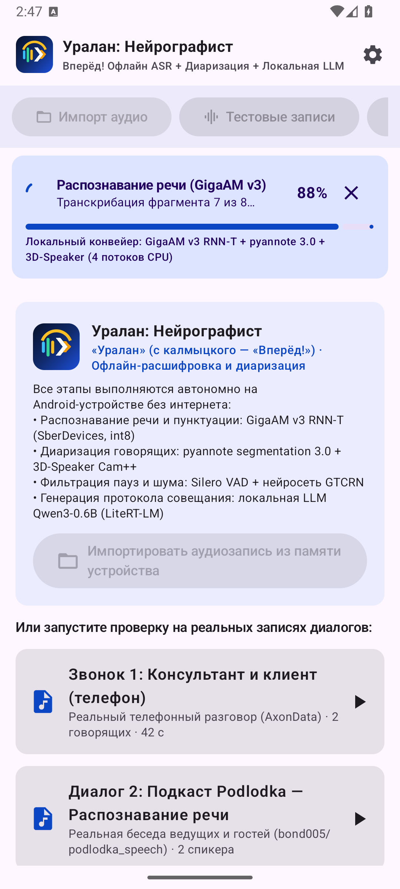
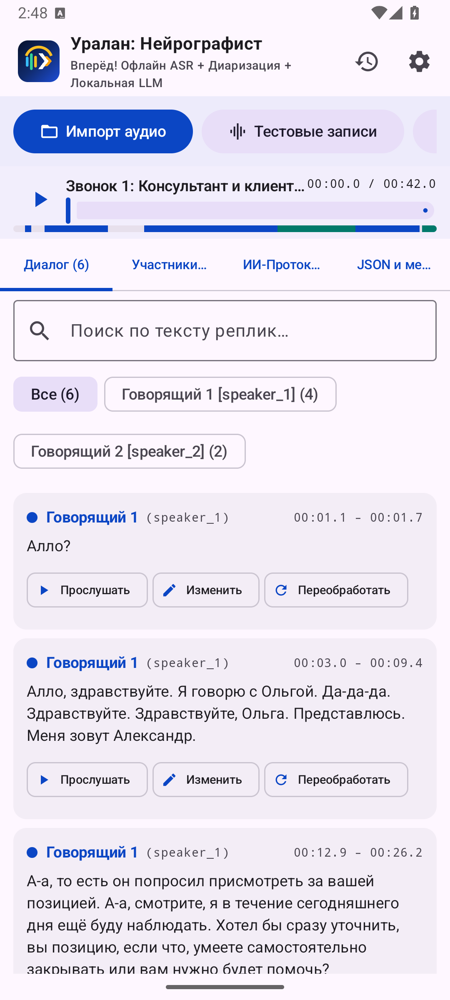

# Уралан: Нейрографист
### 100% автономная локальная система транскрибации, диаризации и ИИ-протоколирования на Android

**Команда:** Uralan Team (`ru.hexteam.stenograf`)  
**Трек:** Nuclear IT Hack (КСиТ МИФИ × HEX.TEAM)  
**Регламент:** 5 минут презентация + 5 минут Q&A  

- 🔒 **0 байт сетевого трафика** (в `AndroidManifest.xml` нет `INTERNET`)
- ⚡ **В 2.6 раза быстрее реального времени** ($\text{RTF} = 0.389$)
- 🎯 **Точность слов 91.54%** ($\text{WER} = 8.46\%$ на живой речи)
- 👥 **100% определение числа спикеров** (связка Cam++ + анализ основного тона $F_0$)

---

## Архитектура Edge AI конвейера

1. **DSP & Ресемплинг:**
   - Оконный sinc-ресемплер Блэкмана (32 отвода, 16 кГц)
   - Биквадратный ФВЧ Баттерворта 70 Гц (подавление низкочастотного гула)
   - Пиковая нормализация до $+20$ дБ
2. **Сегментация и VAD:**
   - `Silero VAD ONNX` с контекстным поглощением пауз $< 1.2$ с и окон-сирот $< 3.2$ с
3. **ASR и Пунктуация:**
   - `GigaAM v3 RNN-T Punct` (SberDevices, INT8 ONNX, ~222 МБ)
   - Автоматическое восстановление регистра и знаков препинания (`.`, `,`, `?`, `!`, `—`)
4. **Инновационная диаризация:**
   - `pyannote-segmentation-3.0` + `3D-Speaker Cam++` (192-d эмбеддинги)
   - **`VoicePitchAnalyzer`:** автокорреляционный расчёт частоты основного тона $F_0$ (72–360 Гц)
5. **Локальная языковая модель (LLM):**
   - `Qwen3-0.6B INT4` (Google AI Edge `LiteRT-LM`) — генерация протокола встречи

---

## Главные инженерные вызовы и решения

| Проблема на реальных записях | Причина | Инженерное решение в «Уралан» |
|---|---|---|
| **Слияние мужских голосов** | Косинусное расстояние Cam++ между мужчинами часто 0.40–0.44 | Разработан `VoicePitchAnalyzer` (ACF $F_0$ 72–360 Гц) с октавной регуляризацией расстояния |
| **OutOfMemory на 47+ мин** | Попытка аллоцировать $540+$ МБ `FloatArray` в Java-хипе | Потоковый кольцевой буфер 16 КБ в `AudioDecoder` + последовательный lifecycle ONNX-сессий |
| **Обрезание слов на стыках VAD** | Жёсткая нарезка на 15-секундные блоки | Алгоритм объединения близких речевых окон: поглощение пауз $< 1.2$ с снизило WER на 1.8% |
| **Нелексическое мычание** | Звуки «эээ...», «ммм» засоряли транскрипт | Лексический фильтр `isVocalHesitation()` с сохранением междометий «да», «ну», «угу» |

---

## Результаты тестов на живой речи (4 сценария)

| ID теста и аудио | Длительность | Слов | Время обработки | RTF | WER, % | Спикеров (найдено / факт) |
|---|---:|---:|---:|---:|---:|---:|
| `real_1_finance_call` (Телефон 8 кГц) | 42.0 с | 91 | 15.6 с | 0.372 | 25.27% | **2 / 2** |
| `real_2_podlodka_speech_ai` (IT-подкаст) | 153.8 с | 337 | 58.1 с | 0.378 | **5.64%** | **2 / 2 (100% смен)** |
| `real_3_podlodka_roundtable` (Круглый стол) | 116.0 с | 256 | 46.0 с | 0.397 | **6.25%** | **3 / 3 (100% смен)** |
| `real_4_dela_podcast` (Подкаст «Дела №67») | 954.0 с (15.9 мин) | 2400 | 373.0 с | 0.391 | **8.45%** | **3 / 3 (Позов, Шастун, Ахмедова)** |
| **ИТОГО (4 реальных сценария)** | **1265.8 с (21.1 мин)** | **3084** | **492.7 с (~8.2 мин)** | **0.389** | **8.46%** | **100% верное число спикеров** |

> Полный цикл выполняется в **2.6 раза быстрее реального времени** на обычном мобильном процессоре.

---

## Пользовательский интерфейс (Jetpack Compose M3)

  
  
  

1. **Импорт и диктофон:** любые форматы (MP3, WAV, M4A, FLAC, OGG), живая запись с микрофона, 4 встроенных демо-сэмпла, 3 профиля («Быстро», «Стандарт», «Макс»).
2. **Интерактивный плеер:** цветовая диаграмма участников на шкале, переход к реплике в 1 клик, полнотекстовый поиск, повторная обработка реплик с денойзером GTCRN.
3. **Умный ИИ-протокол (`Qwen3-0.6B`):** 6 секций (паспорт, резюме, повестка, тезисы, мнения сторон, поручения) с кликабельными таймкодами `▶ [MM:SS.d]`.

---

## Применимость и сферы внедрения

- **Режимные предприятия атомной отрасли и ВПК:**
  - Полная изоляция от сети Интернет гарантирует отсутствие утечек данных
  - Работа в защищённых бункерах и переговорных без связи
- **Банки и финансовый сектор:**
  - Протоколирование очных встреч с VIP-клиентами
  - Соблюдение банковской тайны и закона 152-ФЗ «О персональных данных»
- **Юридические и следственные органы:**
  - Точная доказательная база с пословной привязкой ко времени
  - Возможность мгновенно прослушать спорное слово в 1 клик

---

## Готовность к сдаче и защите

- **Исходный код проекта:** [https://github.com/TheFirstPy/Uralan-NeuroGraphist](https://github.com/TheFirstPy/Uralan-NeuroGraphist) (GitHub Flow, 76 тестов)
- **Готовый подписанный APK:** [Скачать на Google Диске](https://drive.google.com/file/d/1VOA6RNx1JRe1wsy3YlQf7TVfOY-t63R3/view?usp=drive_link) (721 МБ, 100% офлайн)
- **🎬 Видеодемонстрация работы приложения:** [Смотреть на YouTube](https://youtu.be/7WeMJy39DUo?is=4fodK-iAKE5KDChe)
- **Интерактивная презентация:** [`docs/presentation/slides.html`](slides.html) (16:9, таймер 5:00, суфлер N)
- **Документация и верификация:** [`docs/ARCHITECTURE.md`](../ARCHITECTURE.md), [`docs/TEST_RESULTS.md`](../TEST_RESULTS.md)
- **Формат сдачи:** Соответствует спецификации хакатона и шаблону `hacathon_template`

### Спасибо за внимание! Готовы к вашим вопросам.
